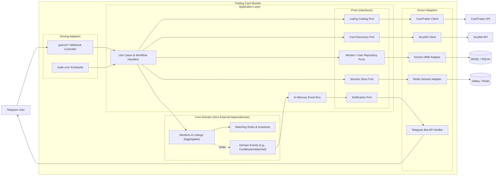

# Trading Card Monitor

[](https://www.typescriptlang.org/)
[](https://nodejs.org/)
[](#hexagonal-architecture-and-ddd)
[](LICENSE)

**Track the Magic: The Gathering singles you care about and get a Telegram message when a matching listing appears.**

> **Demo:** Replace this placeholder with a product screenshot or short GIF.
>
> 

## Table of contents

- [Problem and solution](#problem-and-solution)
- [Key features](#key-features)
- [Domain showcase](#domain-showcase)
- [Architectural highlights](#architectural-highlights)
- [Project structure](#project-structure)
- [Tech stack and engineering decisions](#tech-stack-and-engineering-decisions)
- [Getting started](#getting-started)
- [Configuration table](#configuration-table)
- [Deployment](#deployment)
- [Roadmap and trade-offs](#roadmap-and-trade-offs)

## Problem and solution

Trading card listings and prices can change quickly. Manually checking marketplaces is tedious and inefficient, and you might miss out on the best deals. Trading Card Monitor lets you define the cards, printings, and listing criteria you care about, then checks the market on a schedule and sends matches to you through Telegram.

## Key features

- Track multiple cards and printings.
- Set a maximum price and optional filters (e.g., condition, language, foil status), including market-specific ones (e.g., want to buy using the CardTrader Zero service).
- Receive Telegram notifications when listings match your criteria.
- Manage monitors through an interactive Telegram bot.

## Domain showcase

**What someone wants to track** and **what a marketplace is currently offering** are at the very heart of the domain. These two concepts are represented respectively by the `CardMonitor` and `CardListing` aggregates.

Fundamentally, the core of the application revolves around matching the former against the latter. This matching adheres to domain rules, reflecting buyer expectations: optional criteria do not restrict eligibility, the card's condition is a quality threshold, and marketplace-specific services (e.g., CardTrader's **Zero** hub-based service) can affect whether an otherwise suitable offer is a match.

## Architectural highlights

### Hexagonal Architecture and DDD

Market data, Telegram interactions, and persistence have different concerns and change at different rates. The application keeps its business rules separate from those integrations: the domain models cards, monitors, filters, and match events; application use cases coordinate work through interfaces; infrastructure adapters connect those interfaces to external systems.

This separation makes domain behavior easier to test without Telegram, a live marketplace, or a database. It also gives integrations clear seams: adapters can evolve without making marketplace or framework-specific details part of the domain.



### Modular monolith

The application runs as one process, but its code is divided into focused modules for the domain, use cases, bot UI, marketplace integrations, persistence, and scheduled jobs. This keeps local development and deployment straightforward without giving up clear module boundaries.

The process starts scheduled work alongside the Telegram webhook: active monitors are periodically scanned, and marketplace data is synchronized on a schedule.

## Project structure

The tree below reflects the current codebase. `core/` contains domain concepts, `use-cases/` contains application workflows, and integration modules provide infrastructure adapters.

```text
src/
├── core/                 # Domain entities, value objects, rules, and events
├── use-cases/            # Application workflows
├── bot-ui/               # Core elements of a Bot UI intended as a state machine
├── ui/                   # App-specific state machines and presenters
├── grammy/               # grammY inbound and outbound adapters
├── cardtrader/           # CardTrader models and infrastructure
├── scryfall/             # Scryfall models and adapters
├── drizzle/              # SQL schema, queries, and repository adapters
├── redis/                # Valkey/Redis session storage adapter
├── jobs/                 # Scheduled scanning, synchronization, and cleanup
├── event-bus/            # In-process domain event publisher
├── config/               # Validated application configuration
└── index.ts              # Composition root: wires adapters and starts the app
```

## Tech stack and engineering decisions

| Technology | Purpose | Rationale |
| --- | --- | --- |
| Node.js and TypeScript | Runtime and application language | A single-process runtime with strict types across domain and integration boundaries. |
| grammY and Express | Telegram bot and webhook endpoint | Keeps Telegram transport in an adapter. |
| Drizzle ORM and libSQL | Relational persistence | Typed schema and queries, with a SQLite-compatible local database and libSQL connection support. |
| Valkey / Redis-compatible storage | Bot conversation state | Keeps transient interaction state separate from relational data. |
| CardTrader and Scryfall APIs | Marketplace listings and card search data | Separate market listing retrieval from card discovery and catalog data. |
| XState | Bot conversation workflows | Models multi-step interactions as explicit state machines. |
| `node-cron` | Background scheduled jobs | Runs market scans, catalog synchronization, and data cleanup. |
| Zod and dotenv | Configuration validation | Loads environment settings and reports invalid configuration at startup. |
| Node.js test runner | Automated tests | Uses the built-in test runner for the project’s test suite. |

## Getting started

### Prerequisites

- A current Node.js release and npm.
- A Telegram bot token from [@BotFather](https://t.me/BotFather).
- A CardTrader API token.
- A SQL database supported by libSQL, such as a local SQLite file.
- A Valkey or Redis-compatible server.
- An HTTPS-reachable webhook domain for Telegram.

### Install

```bash
git clone https://github.com/ZicNik/trading-card-monitor.git
cd trading-card-monitor
npm install
```

Copy the included environment template:

```bash
cp .env.example .env
```

### Configure TLS

Telegram webhooks require HTTPS. The app serves HTTPS directly only when both `CERT_PATH` and `KEY_PATH` are configured. Leave those paths unset if HTTPS terminates at a reverse proxy or tunnel (e.g., deployment on a hosting platform).

### Add credentials

Configure the `BOT_TOKEN` and API tokens.

### Prepare the database

Apply the SQLite schema:

```bash
npm run db:push
```

With `DB_URL=file:local.db` and `DB_DIALECT=sqlite`, the configuration defaults to a local SQLite database. For hosted libSQL databases, set your host's database URL, authentication token, and also dialect if necessary (see [Drizzle with Turso](https://turso.tech)).

### Start the key-value store

`REDIS_URL=redis://localhost:6380` points to a local instance of the key-value store running on port `6380`. Have the `valkey-server` executable installed and start Valkey:

```bash
npm run redis:start
```

For hosted key-value stores, just set the `REDIS_URL` provided by your host and skip the above.

### Build and run

```bash
npm run build
npm start
```

The app runs on `PORT` and registers a Telegram webhook using `WEBHOOK_DOMAIN`, with a `GET /ping` for a basic health check.

### Check the code and run tests

```bash
npm run check
npm run lint
npm test
```

The test script loads `.env.test`. The current suite includes database and live API integration tests, so configure test credentials and services separately from development.

## Configuration table

The application validates the configuration at startup.

| Variable | Required | Example | Description |
| --- | --- | --- | --- |
| `BOT_TOKEN` | Yes | `123456:replace-with-your-token` | Telegram bot token from BotFather. |
| `WEBHOOK_DOMAIN` | Yes | `bot.example.com` | Public domain used to register the Telegram HTTPS webhook. Do not include a URL path. |
| `PORT` | Yes | `3000` | Port for the webhook and health-check server. |
| `CERT_PATH` | No | `ssl/cert.pem` | TLS certificate path. Set together with `KEY_PATH` to serve HTTPS directly. |
| `KEY_PATH` | No | `ssl/key.pem` | TLS private key path. Set together with `CERT_PATH` to serve HTTPS directly. |
| `DB_URL` | Yes | `file:local.db` or `libsql://db.example.com` | libSQL database URL. |
| `DB_TOKEN` | No | `replace-with-your-token-if-any` | Authentication token for hosted libSQL databases. Omit for local SQLite. |
| `DB_DIALECT` | For database tooling | `sqlite` or `turso` | Drizzle Kit dialect used by `npm run db:push`. |
| `REDIS_URL` | Yes | `redis://localhost:6380` | Valkey/Redis connection URL for conversation state. |
| `CARDTRADER_TOKEN` | Yes | `replace-with-your-token` | CardTrader API token. |
| `DFLT_TIMEZONE` | Yes | `Europe/Rome` | Default timezone used by the application clock. |

## Deployment

Deploy the app as a single long-running Node.js service. Provide its required environment variables, a reachable SQL database, and a Valkey/Redis-compatible service. Build the project with `npm run build`, then start it with `npm start`.

Configure the hosting provider or reverse proxy to expose the app through HTTPS, forward webhook traffic to `PORT`, and set `WEBHOOK_DOMAIN` to the public hostname. The `/ping` endpoint can be used for a basic health check. Keep one active application instance unless scheduled jobs are coordinated externally: each process starts its own scans and synchronization jobs.

For local development, use a local database and Valkey instance, and expose the webhook server through an HTTPS tunnel. Telegram webhooks require a publicly reachable HTTPS endpoint; starting the app on localhost alone is not sufficient to receive bot updates.

## Roadmap and trade-offs

The current design favors a maintainable single-process service over the operational overhead of microservices. Module boundaries and ports keep the domain and integrations decoupled, while a single deployment keeps coordination simple.

There are deliberate limits:

- **Scheduled scans, not a streaming feed:** active monitors are checked every ten minutes. Notifications are sent when a subsequent scan finds a match, not at the instant a listing is published.
- **Marketplace scope:** CardTrader is the current listing-market integration. Additional markets can be introduced by adding a corresponding module.
- **Rate limits:** API integrations must respect provider limits. CardTrader requests use rate-limiting support; request volume and scan frequency should be reviewed as usage grows.
- **Single-process scheduling:** running multiple app instances duplicates scheduled work. Horizontal scaling would require a coordinated job runner or distributed scheduling strategy.

Potential next steps include adding marketplace adapters, expanding operational observability, and coordinating scheduled jobs for multi-instance deployments.
